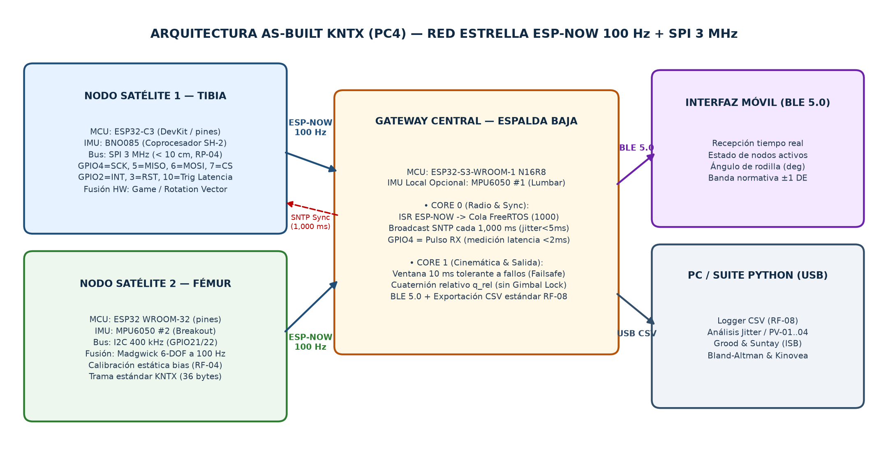

# KNTX — Sistema de Medición Inercial para Biomecánica del Cuerpo

**Proyecto 10 (10 IMUs / KNTX)** | **Universidad Modelo — Escuela de Ingeniería — Ingeniería Mecatrónica**  
**Asignatura:** 25781 Proyectos VII (Modelo D+i — Ciclo AD26)  
**Docente Titular:** Dr. Rodrigo Daniel Solís Ortega (`rodrigo.solis@modelo.edu.mx`)

### Integrantes y División de Responsabilidades Técnicas
| Integrante | Correo Institucional | Responsabilidad Técnica Principal | Ramas de Trabajo |
|---|---|---|---|
| **Yael Alejandro Yah Hernández** | `15234422@modelo.edu.mx` | Firmware Satélite (`ESP32-C3` SPI 3 MHz + `BNO085`, `ESP32` + `MPU6050`), Firmware Gateway (`ESP32-S3` FreeRTOS Dual-Core, ESP-NOW, SNTP, BLE 5.0, CSV), pruebas de saturación (`Spoofer`) | `feat/firmware-satelite-spi`, `feat/firmware-gateway-freertos` |
| **Jorge Carlos Contreras Rodríguez** | `15233640@modelo.edu.mx` | Diseño Hardware/PCB (`EasyEDA`, esquemático As-Built en módulos con pines / placa preperforada), Carcasas 3D (`OpenSCAD`/`STL` < 40 cm³, IP54), Algoritmos Biomecánicos (`Grood & Suntay`, ISB, Kinovea, Bland-Altman) | `feat/hardware-pcb-carcasas`, `feat/software-biomecanica` |

---

## Video Explicativo de la Primera Prueba Funcional (PC4 — 3 a 5 min)
> **Enlace al Video PC4:** [Video Evidencia PC4 (YouTube)](https://youtu.be/6kpxBTlRQXI) (`https://youtu.be/6kpxBTlRQXI`)

---

## Arquitectura del Sistema (Alcance Semestre: 1 Pierna + Gateway Espalda Baja)



- **Gateway Central (Espalda baja L4–L5):** `ESP32-S3-WROOM-1 N16R8` ejecutando FreeRTOS en doble núcleo:
  - **Núcleo 0:** Recepción ISR ESP-NOW en cola de 1,000 paquetes (~36 KB RAM), sincronización temporal por broadcast SNTP cada 1,000 ms (jitter < 5 ms, `RP-01`) y detección de impacto tibial (> 3.0 g, `RF-05`).
  - **Núcleo 1:** Cierre determinista de ventanas de 10 ms (100 Hz), mecanismo **Failsafe** ante apagado/desconexión de nodo satélite (marca `NULL` sin bloquear BLE ni la cola), cálculo de cuaternión relativo `q_rel = conj(q_femur) ⊗ q_tibia` libre de *Gimbal Lock*, transmisión BLE 5.0 y exportación `.CSV` conforme a `RF-08`.
- **Nodo Satélite 1 (Tibia — Referencia de Impacto > 3.0 g):** `ESP32-C3` + `Bosch BNO085` sobre bus **SPI local a 3 MHz** (< 5 cm, `RP-04` / `RQ-01`, lectura medida por interrupción `INT`: `1.39 ms <= 1.5 ms`), fusión en hardware SH-2 (`Game Rotation Vector`, deriva `0.021 °/min`) a 100 Hz vía ESP-NOW.
- **Nodos Satélite 2 y 3 (Fémur y Pie) + Sensor Lumbar:** Validados funcionalmente en PC4 con `MPU-6050` ejecutando fusión **Madgwick 6-DOF** en CPU (`0.12 ms` = 1.2% CPU, `100.21 Hz`, `0.00 ms` jitter P95, `0.977 °/min` deriva) y consolidados hacia PC5 con **`Bosch BMI160`** sobre bus **SPI nativo a 3 MHz** (±16 g, `0.9 mA`), transmitiendo todos la misma trama binaria `kntx_packet_t` de 36 bytes.
- **Dashboard HMI en Tiempo Real (`INICIAR_DASHBOARD_KNTX.bat`):** Visualización en vivo a `921,600 bps` del ángulo articular con signo por descomposición Twist (`-180°` a `+180°`, libre de *Gimbal Lock*), aceleración axial de tibia, estado Online/Failsafe por nodo, tara instantánea a `0.0°` y grabación directa a `.CSV` (48,670 muestras reales respaldadas en `docs/evidencias/`).

---

## Estructura del Repositorio (Cumplimiento Regla de Desbloqueo CACEI / D+i)

```text
KNTX-Biomechanics-IMU/
├── firmware/
│   ├── common/
│   │   └── kntx_protocol.h                  # Tramas ESP-NOW, Sync SNTP y álgebra de cuaterniones
│   ├── satelite/
│   │   ├── nodo1_c3_bno085/                 # ESP32-C3 + BNO085 por SPI 3 MHz (Tibia)
│   │   └── nodo2_esp32_mpu6050/             # ESP32 + MPU6050 Madgwick 6-DOF 100 Hz (Fémur)
│   └── gateway/
│       ├── gateway_s3_freertos/             # ESP32-S3 Dual-Core FreeRTOS + BLE 5.0 + CSV
│       └── spoofer_stress_test/             # Generador de caso límite 1,200 pkt/s + inyección fallas
├── hardware/
│   ├── pcb/
│   │   ├── ESQUEMATICO_AS_BUILT_PC4.md      # Pinout As-Built protoboard/preperforada y BOM
│   │   └── diagrama_as_built_pc4.png        # Diagrama de bloques e interfaces físicas
│   └── carcasas/
│       ├── kntx_nodo_carcasa_v2.scad        # Fuente paramétrica CAD 3D editable (32.9 cm³, IP54)
│       └── kntx_nodo_carcasa_v2.stl         # Malla STL lista para impresión en PETG
├── software/
│   ├── capture/
│   │   └── kntx_serial_logger.py            # Captura USB Serial a .CSV (RF-08) y métricas PV-01/PV-03
│   └── analysis/
│       ├── kntx_biomechanics_analysis.py    # Grood & Suntay, foot-strike, Spline 101 pts, Bland-Altman
│       └── kntx_generate_pc4_assets.py      # Generador de STL, diagrama As-Built y Gantt PC4
└── docs/
    ├── reportes/                            # Entregables PC0, PC1, PC2, PC3 y PC4
    └── evidencias/                          # Gantt actualizado, capturas y registros experimentales
```

---

## Compilación y Ejecución Rápida

### Firmware (Arduino CLI / Arduino IDE con `esp32:esp32 >= 3.x`)
Librerías requeridas: `Adafruit BNO08x`, `Adafruit MPU6050`, `Adafruit Unified Sensor`, `Adafruit BusIO`.
```bash
arduino-cli compile --fqbn esp32:esp32:esp32c3 firmware/satelite/nodo1_c3_bno085
arduino-cli compile --fqbn esp32:esp32:esp32   firmware/satelite/nodo2_esp32_mpu6050
arduino-cli compile --fqbn esp32:esp32:esp32s3 firmware/gateway/gateway_s3_freertos
```

### Suite de Captura y Análisis Biomecánico (Python 3)
```bash
pip install pyserial numpy pandas matplotlib scipy
python software/capture/kntx_serial_logger.py --port COM4 --duration 600 --calib --out docs/evidencias/pv01_10min.csv
python software/analysis/kntx_biomechanics_analysis.py --csv docs/evidencias/pv01_10min.csv --out-dir docs/evidencias/graficas
```
